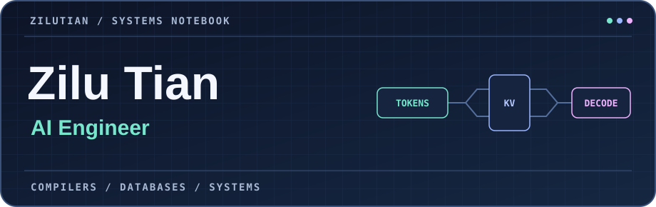
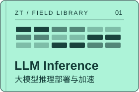
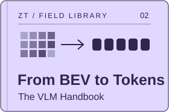
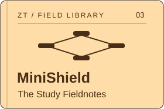

Compiler, database & systems engineer — AI inference, query optimization, performance profiling. PhD (EPFL). SIGMOD · ASPLOS · ICDT.

**On this page:** [Books](#books) · [Projects](#projects) · [Research](#selected-publications)

---

## Books

- **[大模型推理部署与加速](https://github.com/ZiluTian/ai-infra-prep)** · Chinese · Trace a request from its KV cache to a distributed serving cluster, then try the runnable labs.
- **[From BEV to Tokens](https://zilutian.github.io/vlm-book/)** · Follow the tensor shapes from image features to language tokens. [Source](https://github.com/ZiluTian/vlm-book).
- **[MiniShield](https://zilutian.github.io/minishield/)** · Build LLVM passes in C++ across three volumes: foundations, transformations, and hardening. [Source](https://github.com/ZiluTian/minishield).

## Projects

- **[watup-llm](https://github.com/ZiluTian/watup-llm)** — Follow the transformer decode hot path through a 12-kernel CUDA GEMV ladder, with cache-cold measurements on an RTX 5090.
- **[it-assistant](https://github.com/ZiluTian/it-assistant)** — Serving Qwen3.8-27B on two GTX 1080 Ti cards: **26.1 vs. 15.4 tok/s** with the model's own MTP head. A separate 4B draft model was slower in that setup. [Benchmark methodology](https://github.com/ZiluTian/it-assistant/blob/main/BENCHMARKS.md).
- **[minishield](https://github.com/ZiluTian/minishield)** — An LLVM New Pass Manager plugin. Stats, CFG analysis, and eligibility checks are implemented; the flattening rewrite is still stubbed in the plugin, with the design covered in the book.
- **[RegularPathQuery](https://github.com/ZiluTian/RegularPathQuery)** — An output-sensitive C++ graph query engine with parallel execution (ICDT 2026).
- **[torch-hostdev-lint](https://github.com/ZiluTian/torch-hostdev-lint)** — A static PyTorch linter for CPU↔GPU syncs hidden in hot loops.
- **[gitlab-mr-tracker](https://github.com/ZiluTian/gitlab-mr-tracker)** — A terminal dashboard that follows GitLab CI and discussion as a merge request's head changes.

**Tools I use:** CUDA · Triton · LLVM / MLIR · TVM · PyTorch · llama.cpp · C++ · Scala

---

## Selected publications

- M. Abo Khamis, A.-M. Hurjui, A. Kara, D. Olteanu, D. Suciu, **Z. Tian**. *Output-sensitive evaluation of acyclic conjunctive regular path queries.* **ICDT 2026**.
- **Z. Tian**, D. Olteanu, C. Koch. *Using process calculus for optimizing data and computation sharing in complex stateful parallel computations.* **SIGMOD 2025**.
- **Z. Tian**, P. Lindner, M. Nissl, C. Koch, V. Tannen. *Generalizing bulk-synchronous parallel processing for data science: From data to threads and agent-based simulations.* **SIGMOD 2023**.
- **Z. Tian**. *Multi-stage vertex-centric programming for agent-based simulations.* **GPCE 2023**.
- A. Pourhabibi Zarandi, S. Gupta, H. Kassir, M. Sutherland, **Z. Tian**, M. P. Drumond, B. Falsafi, C. Koch. *Optimus Prime: accelerating data transformation in servers.* **ASPLOS 2020**.
- **Z. Tian**, H. Ajallooiean. *CloudSuite tutorial.* **ISPASS 2019**.

Patent: hardware acceleration of data transformation (WO2021037341 / US11748254).

## More projects

- [BSPModel](https://github.com/ZiluTian/BSPModel): typed model and staged compiler for parallel stateful computation (SIGMOD 2025)
- [SIGMOD23Experiments](https://github.com/ZiluTian/SIGMOD23Experiments): simulation workloads on Spark, GraphX, Giraph, Flink, and a custom runtime (SIGMOD 2023, GPCE 2023)
- [DifferentiableABS](https://github.com/ZiluTian/DifferentiableABS): differentiable, staged agent-based simulation in Scala
- [DesignConceptsInPL](https://github.com/ZiluTian/DesignConceptsInPL): mini-languages implemented in Scala 3
- [latex-tutorial-chinese](https://github.com/ZiluTian/latex-tutorial-chinese): a systematic Chinese-language LaTeX tutorial (★ 18)
- [scheduleForMe](https://github.com/ZiluTian/scheduleForMe): a personal scheduling app in Scala
